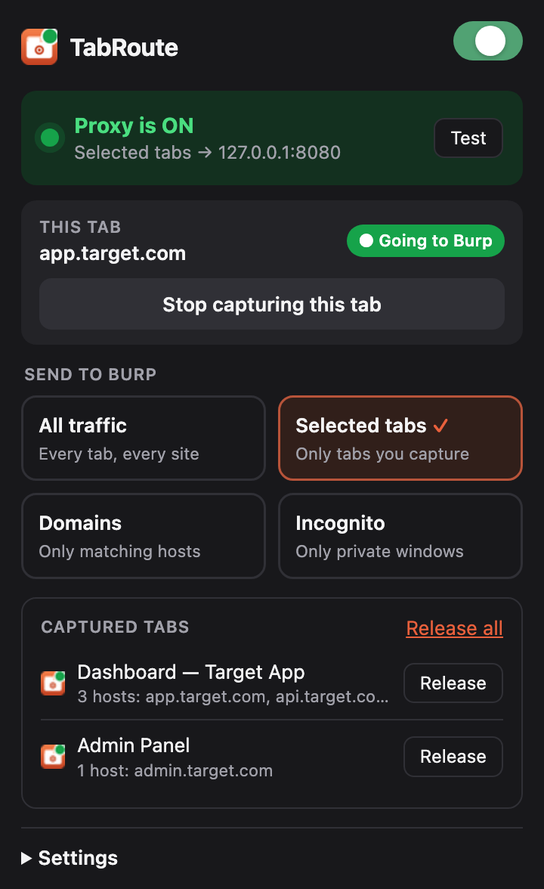
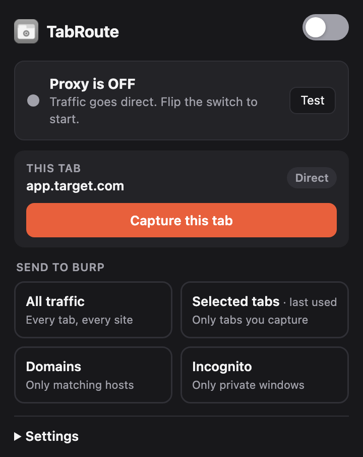
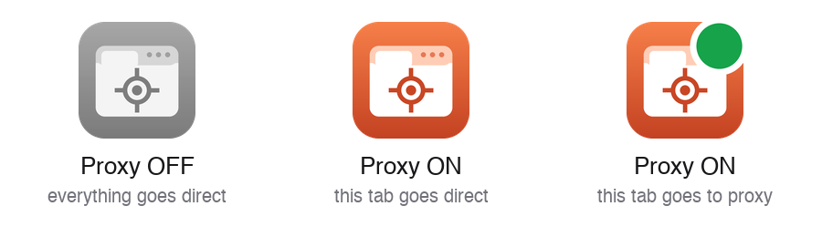

<p align="center">
  
</p>

<h1 align="center">TabRoute</h1>

<p align="center">
  <b>Chrome-এর জন্য ট্যাব ধরে ধরে প্রক্সি সুইচার।</b><br>
  নির্দিষ্ট একটা ট্যাব, বাছাই করা ডোমেইন, বা ইনকগনিটো উইন্ডোর ট্রাফিক Burp Suite-এ (বা যেকোনো HTTP প্রক্সিতে) পাঠাও। বাকি ব্রাউজিং আগের মতোই সরাসরি যাবে।
</p>

<p align="center"><a href="README.md">Read in English</a></p>

---

## কেন TabRoute

FoxyProxy-এর মতো টুল ব্রাউজারের **সব** ট্রাফিক প্রক্সিতে পাঠায়। টেস্টিংয়ের সময় এতে Burp-এর history ইমেইল, গান আর অন্য সব ট্যাবের ট্রাফিকে ভরে যায়।

TabRoute দিয়ে তুমি নিজে ঠিক করতে পারো কোন ট্রাফিক প্রক্সিতে যাবে:

| মোড | কী প্রক্সিতে যাবে |
|---|---|
| **All traffic** | সব ট্রাফিক (FoxyProxy-এর মতো) |
| **Selected tabs** | শুধু তুমি যে ট্যাবগুলো ক্যাপচার করবে |
| **Domains** | শুধু প্যাটার্নে মেলা হোস্ট, যেমন `*.target.com` |
| **Incognito** | শুধু ইনকগনিটো উইন্ডো, পুরোপুরি আলাদা থাকে |

<p align="center">
  
  &nbsp;&nbsp;
  
</p>

## ফিচার

- **এক ক্লিকে চালু/বন্ধ।** আবার চালু করলে আগের ব্যবহার করা মোডটাই ফিরে আসে।
- **টুলবারের আইকন দেখে বোঝা যায় এই ট্যাব প্রক্সিতে যাচ্ছে কিনা:**
  - ধূসর: প্রক্সি বন্ধ
  - কমলা: প্রক্সি চালু, কিন্তু এই ট্যাব সরাসরি যাচ্ছে
  - কমলা + সবুজ বিন্দু: এই ট্যাব প্রক্সিতে যাচ্ছে

  

- **ট্যাব ক্যাপচার** করা যায় পপআপ থেকে, অথবা <kbd>Alt</kbd>+<kbd>Shift</kbd>+<kbd>B</kbd> চেপে।
- **রিকোয়েস্ট ট্যাগিং:** ক্যাপচার করা ট্যাবের প্রতিটা রিকোয়েস্টে `X-Burp-Tab: tab-<id>` হেডার যোগ হয়, তাই Burp-এ ফিল্টার করা যায়।
- **Never proxy লিস্ট:** বিরক্তিকর হোস্টগুলো (টেলিমেট্রি, আপডেট) এখানে দিলে কখনো প্রক্সিতে যাবে না।
- **Test** বাটন দিয়ে Burp চলছে কিনা দেখা যায়, আর Burp CA সার্টিফিকেট ডাউনলোডের লিংক আছে।
- লাইট আর ডার্ক থিম।
- **কোনো ট্র্যাকিং নেই, বাইরের কোড নেই, কোনো লাইব্রেরি নেই।** বিস্তারিত [PRIVACY.md](PRIVACY.md)-তে।

## ইনস্টল

1. [Releases](https://github.com/rafsanzami/tabroute/releases) থেকে সর্বশেষ `tabroute-vX.Y.Z.zip` ডাউনলোড করে আনজিপ করো, অথবা repo-টা clone করো।
2. Chrome-এ `chrome://extensions` খোলো।
3. ওপরে ডানদিকে **Developer mode** চালু করো।
4. **Load unpacked** চাপো, তারপর আনজিপ করা ফোল্ডারটা সিলেক্ট করো (যেটার ভেতরে `manifest.json` আছে)।
5. TabRoute-কে টুলবারে পিন করে রাখো।
6. *(Incognito মোড ব্যবহার করতে চাইলে)* TabRoute-এর **Details** পেজে গিয়ে **Allow in Incognito** চালু করো।

Chrome, Edge, Brave আর অন্যান্য Chromium ব্রাউজারে কাজ করে।

## শুরু করার নিয়ম

1. Burp চালু করো। ডিফল্ট প্রক্সি `127.0.0.1:8080`। তোমারটা অন্য হলে **Settings**-এ বদলে নাও।
2. TabRoute খুলে **Test** চাপো, দেখো Burp পাওয়া যাচ্ছে কিনা।
3. Burp-এর CA সার্টিফিকেট আগে ইনস্টল না করে থাকলে করে নাও (**Settings → Download Burp CA cert**)।
4. টার্গেট সাইট খোলো, তারপর **Capture this tab** চাপো।

ট্যাবটা রিলোড হবে, আইকনে সবুজ বিন্দু দেখাবে, আর ট্যাবের রিকোয়েস্টগুলো Burp-এ আসতে শুরু করবে।

## "Selected tabs" মোড কীভাবে কাজ করে

Chrome-এর প্রক্সি সেটিং পুরো ব্রাউজারের জন্য একটাই, ট্যাব ধরে আলাদা করা যায় না। তাই TabRoute এভাবে কাজ করে:

1. ট্যাব ক্যাপচার করলে সেই ট্যাব যে যে হোস্টে রিকোয়েস্ট পাঠায় (মূল সাইট, API, CDN, iframe), TabRoute সেগুলো মনে রাখে।
2. শুধু ওই হোস্টগুলো প্রক্সিতে পাঠানোর জন্য একটা PAC স্ক্রিপ্ট বানায়। বাকি সব সরাসরি যায়।
3. ওই ট্যাবের প্রতিটা রিকোয়েস্টে `X-Burp-Tab` হেডার যোগ করে।

**সীমাবদ্ধতা**

- ক্যাপচার করা ট্যাব কোনো নতুন হোস্টে **প্রথমবার** রিকোয়েস্ট পাঠালে, সেটা সরাসরি চলে যেতে পারে, কারণ PAC স্ক্রিপ্ট আপডেট হতে এক মুহূর্ত লাগে। ক্যাপচারের সময় ট্যাব রিলোড হয়, তাই মূল হোস্টটা কখনো বাদ পড়ে না।
- অন্য কোনো ট্যাব একই হোস্টে গেলে (যেমন `fonts.googleapis.com`) সেটাও প্রক্সিতে যাবে। হেডার দিয়ে আলাদা করতে হবে (নিচে দেখো)।

একদম আলাদা রাখতে চাইলে **Incognito** মোড ব্যবহার করো। টার্গেট সাইটটা ইনকগনিটো উইন্ডোতে খুললে শুধু সেটার ট্রাফিক প্রক্সিতে যাবে।

## Burp-এর জন্য টিপস

**শুধু ক্যাপচার করা ট্যাবের ট্রাফিক দেখতে:** Proxy → HTTP history → Filter → Bambda-তে লেখো:

```java
return requestResponse.request().hasHeader("X-Burp-Tab");
```

**নির্দিষ্ট একটা ট্যাবের ট্রাফিক দেখতে:**

```java
return "tab-123".equals(requestResponse.request().headerValue("X-Burp-Tab"));
```

**শুধু ক্যাপচার করা ট্যাবের রিকোয়েস্ট intercept করতে:** Proxy settings → Request interception rules → Add → *Match type:* Header, *Relationship:* Matches, *Condition:* `X-Burp-Tab`।

**হেডারটা টার্গেট সার্ভারে পাঠাতে না চাইলে:** Proxy settings → Match and replace → Add → *Type:* Request header, *Match:* `^X-Burp-Tab:.*$`, *Replace:* (খালি)।

চাইলে **Settings** থেকে হেডার ট্যাগিং বন্ধও করে দিতে পারো।

## সতর্কতা

TabRoute শুধু সেইসব অ্যাপ্লিকেশন টেস্ট করার জন্য, যেগুলো টেস্ট করার **অনুমতি তোমার আছে**। এটা একটা স্বাধীন প্রজেক্ট, PortSwigger Ltd-এর সাথে কোনো সম্পর্ক নেই। Burp Suite হলো PortSwigger Ltd-এর ট্রেডমার্ক।

## লাইসেন্স

[MIT](LICENSE) © 2026 rafsanzami
