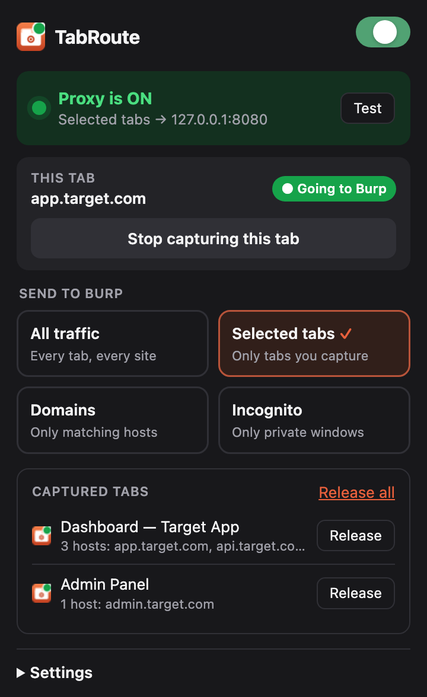
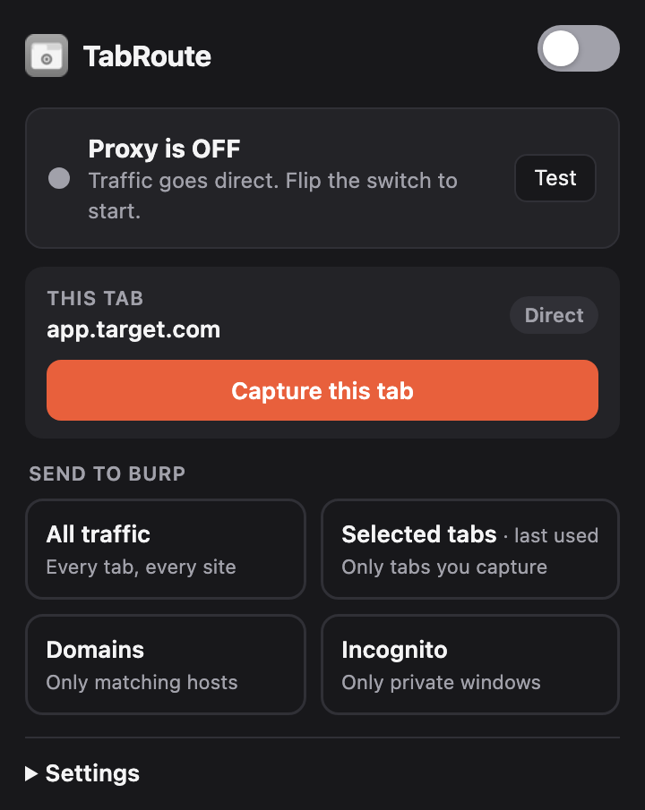
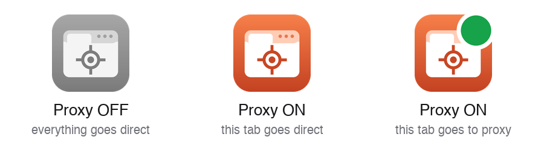

<p align="center">
  
</p>

<h1 align="center">TabRoute</h1>

<p align="center">
  <b>Per-tab proxy switcher for Chrome.</b><br>
  Send one tab, chosen domains, or incognito windows to Burp Suite (or any HTTP proxy) and leave the rest of your browsing alone.
</p>

<p align="center">
  <a href="LICENSE"></a>
  
  
</p>

<p align="center"><a href="README.bn.md">বাংলায় পড়ুন</a></p>

---

## Why

Most proxy switchers send **all** browser traffic to your proxy. While testing, that means your Burp history fills up with email, music, docs and every other tab you have open.

TabRoute lets you choose what goes to the proxy:

| Mode | What goes to the proxy |
|---|---|
| **All traffic** | Everything |
| **Selected tabs** | Only the tabs you capture |
| **Domains** | Only hosts that match your patterns, e.g. `*.target.com` |
| **Incognito** | Only incognito windows (strict isolation) |

<p align="center">
  
  &nbsp;&nbsp;
  
</p>

## Features

- **One-click on/off switch**. Turning it back on restores your last mode.
- **The toolbar icon shows the state of the current tab**:

  

- **Capture a tab** from the popup or with <kbd>Alt</kbd>+<kbd>Shift</kbd>+<kbd>B</kbd>.
- **Request tagging**: requests from captured tabs carry an `X-Burp-Tab: tab-<id>` header, so you can filter them in Burp.
- **Never-proxy list** for noisy hosts (telemetry, updates, and so on).
- **Test connection** button and a quick link to download the Burp CA certificate.
- Light and dark theme.
- **No tracking, no remote code, no dependencies.** See [PRIVACY.md](PRIVACY.md).

## Install

### From GitHub (developer mode)

1. Download the latest `tabroute-vX.Y.Z.zip` from [Releases](https://github.com/rafsanzami/tabroute/releases) and unzip it, or clone this repo.
2. Open `chrome://extensions` in Chrome.
3. Turn on **Developer mode** (top right).
4. Click **Load unpacked** and select the unzipped folder (the one that contains `manifest.json`).
5. Pin TabRoute to the toolbar.
6. *(Optional, for Incognito mode)* On TabRoute's **Details** page, turn on **Allow in Incognito**.

Works in Chrome, Edge, Brave and other Chromium browsers.

## Quick start

1. Start Burp. The default proxy listener is `127.0.0.1:8080`. If yours is different, change it in **Settings**.
2. Open TabRoute and press **Test** to check that Burp is reachable.
3. Install Burp's CA certificate if you haven't already (**Settings → Download Burp CA cert**).
4. Open your target site, then click **Capture this tab**.

The tab reloads, the icon gets a green dot, and the tab's requests show up in Burp.

## How "Selected tabs" works

Chrome's proxy API applies to the whole browser, not to a single tab. TabRoute works around this:

1. When you capture a tab, TabRoute records every host that tab talks to (main site, APIs, CDNs, iframes).
2. It builds a PAC script that sends only those hosts to the proxy. Everything else goes direct.
3. It adds an `X-Burp-Tab` header to every request from that tab.

**Known limitations**

- The **first** request a captured tab makes to a host it hasn't used before can go direct, because the PAC script takes a moment to update. The tab is reloaded when you capture it, so its main host is never missed.
- If another tab talks to the same host (for example `fonts.googleapis.com`), that traffic goes to the proxy too. Use the header to tell them apart (see below).

For strict isolation, use **Incognito** mode: open the target in an incognito window and only that window is proxied.

## Burp tips

**Show only captured-tab traffic.** In Proxy → HTTP history → Filter → Bambda:

```java
return requestResponse.request().hasHeader("X-Burp-Tab");
```

**Show one specific tab:**

```java
return "tab-123".equals(requestResponse.request().headerValue("X-Burp-Tab"));
```

**Intercept only captured tabs.** Proxy settings → Request interception rules → Add → *Match type:* Header, *Relationship:* Matches, *Condition:* `X-Burp-Tab`.

**Keep the header away from the target server.** Proxy settings → Match and replace → Add → *Type:* Request header, *Match:* `^X-Burp-Tab:.*$`, *Replace:* (empty).

You can also turn tagging off in **Settings**.

## Settings

| Setting | Description |
|---|---|
| Proxy host / port | Where to send traffic. Default `127.0.0.1:8080` |
| Domains | One pattern per line. `*.site.com` also matches `site.com` |
| Never proxy | Applied in every mode. `<local>` means plain hostnames with no dot |
| Tag header | Header name added to captured-tab requests. Default `X-Burp-Tab` |
| Reload on capture | Reload a tab when you capture it, so no request is missed |

## Permissions

| Permission | Why |
|---|---|
| `proxy` | To set the browser's proxy configuration |
| `webRequest` + `<all_urls>` | To learn which hosts a captured tab talks to. TabRoute only observes requests and never blocks or changes them |
| `declarativeNetRequest` | To add the `X-Burp-Tab` header to captured-tab requests |
| `tabs` | To show the current tab's host and the captured tab list |
| `storage` | To save your settings locally |

## Contributing

Issues and pull requests are welcome. The extension is plain JavaScript with no build step:

```
manifest.json   extension manifest (MV3)
background.js   proxy logic, PAC generation, tab tracking, icon state
popup.*         popup UI
icons/          toolbar icons (icon = idle, on = active, off = disabled)
scripts/        release packaging
```

To build a release zip, run `./scripts/package.sh`. The zip is written to `dist/`.

## Disclaimer

TabRoute is for testing applications **you are authorized to test**. It is an independent project and is not affiliated with or endorsed by PortSwigger Ltd. Burp Suite is a trademark of PortSwigger Ltd.

## License

[MIT](LICENSE) © 2026 rafsanzami
